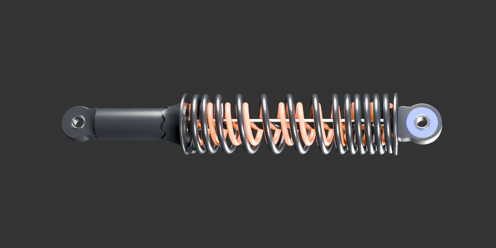

# Répétitions provisoires — décision de méthode

La proposition concerne une **moto de revue complète**, avec copies de travail des pièces identiques documentées. Les sources détaillées restent inchangées ; leurs défauts et incertitudes restent signalés. Aucune réception artistiqueG8 n’est déclarée.

Le workflow actuel exige : « Répéter un motif ou générer des variantes seulement après réception de son exemplaire. » [Règle du dépôt](../README.md#workflow-commun). Cette proposition demande une exception limitée aux instances provisoires de la moto, avant réception artistique. **Elle n’est pas encore autorisée ni exécutée.**

Exemples concrets : un amortisseur existant pour présenter une paire ; le duo extérieur lentille/boîtier pour présenter quatre clignotants. Les quatre tiges LH/RH restent leurs sources indépendantes. La même méthode pourrait servir à la petite quincaillerie identique seulement après documentation de sa référence/quantité et gel d’un exemplaire effectivement examiné.

[Amortisseur — sources et limites](../../reviews/rear-sns-rest-assembly-v3/README.md) : variante apparentée, proportions/sections et pose estimées ; pas de montage reçu.

[Clignotant — natifs96 et vrai moteur](../../reviews/indicator-exemplar-context-v1/README.md) : teinte assombrie par le boîtier vide ; ampoule/réflecteur et raccord de tige non reçus. Ce duo n’est pas déclaré clignotant fonctionnel terminé.

Les répétitions proposées permettent de juger l’ensemble avec ses pièces à chaque emplacement. Elles ne corrigent pas automatiquement les matières ou les interfaces et ne permettent pas d’inventer les inconnues critiques du phare. Les révisions, références et empreintes exactes sont consignées dans [le plan machine](plan.json).
